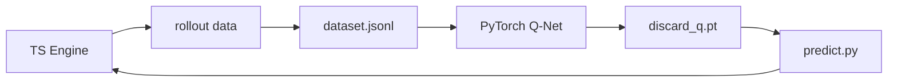

# Maj_Mini

[中文](./README.md) | **English**

A playground and AI-training framework for **Sichuan Mahjong** (川麻) with two
signature rules: 缺门 (que-men / forced missing suit) and 血战到底 (blood battle).

- **Game engine**: Bun + TypeScript full rules (win detection, que-men, pong/kong/win, fan, 流局).
- **AI**: rollout-simulated supervised data trained by a PyTorch Q-network.

## Overview



## Quick start

```bash
bun install
uv sync --project agent
bun run typecheck  # type-check
bun run test       # unit tests
bun run demo       # logic smoke test
bun run game       # bot-vs-bot round (terminal)
```

## Data → train → inference

```bash
bun run train:data:repro        # reproducible dataset (seed 42)
cd agent && uv run python train.py \
  --data dataset.jsonl \
  --relative-advantage --normalize-reward --patience 20 \
  --out discard_q.pt
bun run game
```

## Concepts

- **TileId**: `w1` `t5` `b9` — the 27 tile kinds.
- **queSuit**: the missing suit to clear before a win.
- **Feature vector**: 30 dims = 27 tile counts + 3 que-suit one-hot.
- **advantage**: rollout-estimated expected score; learn which discard relative to the hand.

## Doc index

- [docs/architecture.md](./docs/architecture.md) — internal design
- [docs/deployment.md](./docs/deployment.md) — deployment guide

## License

MIT — see [LICENSE](../LICENSE). © 2026 aDarkMaker