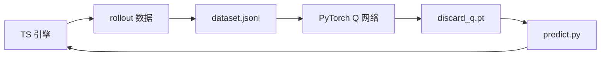

# Maj_Mini

<!-- language-switch -->
**中文** · [English](#english) · [中文文档](#chinese-中文)
<!-- /language-switch -->

A playground and AI-training framework for **Sichuan Mahjong** (川麻) with two
signature rules: 缺门 (que-men / forced missing suit) and 血战到底 (blood battle).

---

<!-- 中文段 START -->
## 中文 (Chinese)

一个以**四川麻将**（缺门 / 血战到底）为场景的 playground 与 AI 训练框架。

- **游戏引擎**：Bun + TypeScript 实现完整规则（胡牌判定、缺门强制、碰杠胡、番数、流局结算）
- **AI 训练**：通过 rollout 模拟生成监督数据，由 PyTorch Q 网络学习「该打哪张」

### 概览



### 快速开始

```bash
bun install                # 安装 TS 依赖
uv sync --project agent    # 安装 Python 依赖

bun run typecheck          # 类型检查
bun run test               # 单元测试
bun run demo               # 逻辑冒烟
bun run game               # 终端对局（bot vs bot）
```

### 数据 → 训练 → 推理

```bash
bun run train:data:repro        # 生成可复现数据集（seed 42）→ agent/dataset.jsonl
cd agent && uv run python train.py \
  --data dataset.jsonl \
  --relative-advantage --normalize-reward --patience 20 \
  --out discard_q.pt
bun run game                    # 使用训练好的模型对战
```

### 核心概念

- **Tile**：`w1` `t5` `b9` —— 27 种牌。
- **queSuit**：缺门花色，必须清光才能胡。
- **特征向量**：30 维 = 27 维手牌计数 + 3 维缺门 one-hot。
- **reward / advantage**：rollout 估计的期望净分；`--relative-advantage` 学习
  同一手内最优出牌。

---

## English (en)

<!-- English 段 -->

An AI-training arena for **Sichuan Mahjong**. The engine enforces 缺门 (draw-and-discard
a forced missing suit) and 血战到底 (play continues until three wins or the wall runs out).

- **Game engine**: Bun + TypeScript full rules (win detection, que-men, pong/kong/win, fan, 流局).
- **AI**: rollout-simulated supervised data trained by a PyTorch Q-network.

### Quick start

```bash
bun install
uv sync --project agent
bun run typecheck  # type-check
bun run test       # unit tests
bun run game       # bot-vs-bot round (terminal)
```

### Data → train → inference

```bash
bun run train:data:repro        # reproducible dataset (seed 42)
cd agent && uv run python train.py \
  --data dataset.jsonl \
  --relative-advantage --normalize-reward --patience 20 \
  --out discard_q.pt
bun run game
```

### Concepts

- **TileId**: `w1` `t5` `b9` — the 27 tile kinds.
- **queSuit**: the missing suit to clear before a win.
- **Feature vector**: 30 dims = 27 tile counts + 3 que-suit one-hot.
- **advantage**: rollout-estimated expected score; learn which discard relative to the hand.

---

## 文档索引 (Doc index)

- [docs/architecture.md](./docs/architecture.md) — 架构设计 / internal design
- [docs/deployment.md](./docs/deployment.md) — 部署 & 运行指南

## License

MIT — see [LICENSE](../LICENSE). © 2026 aDarkMaker