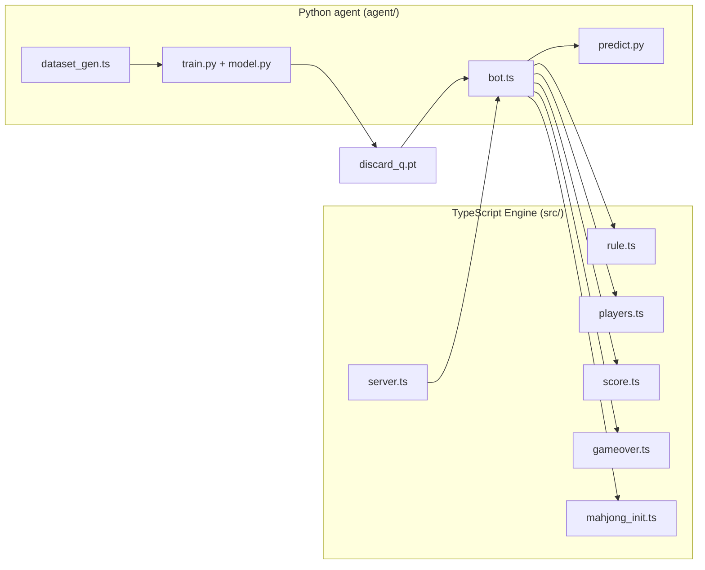
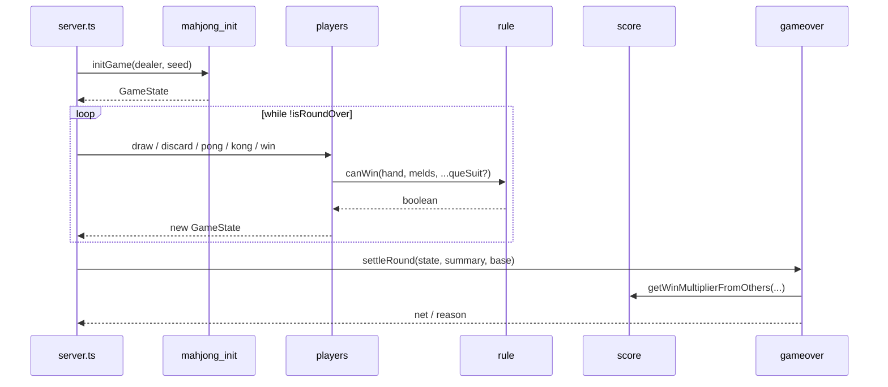
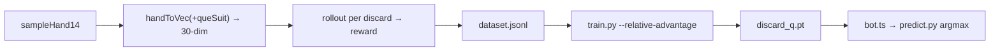

# Architecture

四川麻将（定缺 / 血战到底）是一个「游戏引擎 + AI 训练」双栈项目。

## Engine data flow

## Training pipeline

- The model is a supervised Q-network: **input** = 30 features (27 tile counts + 3
  que-suit flags), **output** = expected value per discard tile (27 actions). At
  inference the legal-discard mask zeroes invalid tiles, then argmax picks the play.