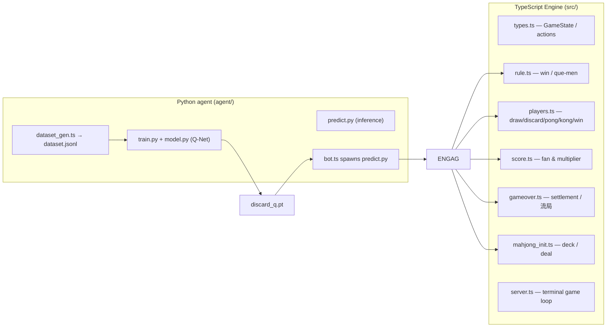
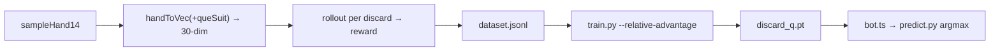

# Architecture

四川麻将（定缺 / 血战到底）是一个「游戏引擎 + AI 训练」双栈项目。



## Engine data flow

```mermaid
sequenceDiagram
    participant S as server.ts
    participant I as mahjong_init
    participant P as players
    participant R as rule
    participant Sco as score
    participant G as gameover

    S->>I: initGame(dealer, seed)
    I-->>S: GameState
    loop while !isRoundOver
        S->>P: draw / discard / pong / kong / win
        P->>R: canWin(hand, melds, ...queSuit?)
        R-->>P: boolean
        P-->>S: new GameState
    end
    S->>OVER: settleRound(state, summary, base)
    OVER->>Sco: getWinMultiplierFromOthers(...)
    OVER-->>S: net / reason
```

## Training pipeline



- The model is a supervised Q-network: **input** = 30 features (27 tile counts + 3
  que-suit flags), **output** = expected value per discard tile (27 actions). At
  inference the legal-discard mask zeroes invalid tiles, then argmax picks the play.