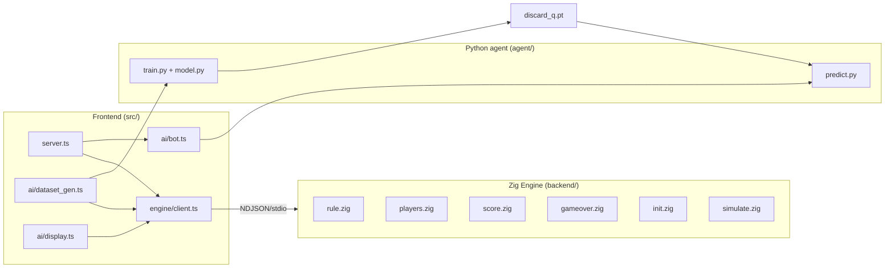
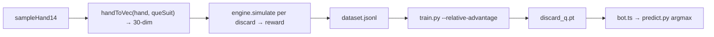

# Architecture

四川麻将（定缺 / 血战到底）是一个「Zig 规则引擎 + Bun/TS 前端 + AI 训练」的项目。

## Engine data flow

```mermaid
sequenceDiagram
    participant S as server.ts
    participant C as engine/client.ts
    participant E as maj_engine (Zig)

    S->>C: engine.init(dealer, seed)
    C->>E: {"id":1,"cmd":"init",...}
    E-->>C: GameState
    C-->>S: GameState
    loop while !isRoundOver
        S->>C: draw / discard / pong / kong / win
        C->>E: NDJSON request
        E-->>C: new GameState
        C-->>S: new GameState
    end
    S->>C: engine.settle(state, summary, base)
    C->>E: {"cmd":"settle",...}
    E-->>C: net / reason
    C-->>S: net / reason
```

每个请求在引擎侧使用独立 arena 分配器，请求结束后重置，避免内存增长。

## Training pipeline

- The model is a supervised Q-network: **input** = 30 features (27 tile counts + 3
  que-suit flags), **output** = expected value per discard tile (27 actions). At
  inference the legal-discard mask zeroes invalid tiles, then argmax picks the play.
