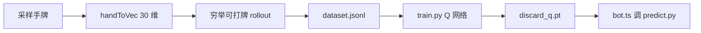

# AI 训练

AI 训练采用**监督学习（回归）**范式：用 rollout 估计每个出牌动作的期望净分作为标签，训练 Q 网络拟合。

## 训练流水线



## 模型

`agent/model.py` 的 `DiscardQ` 是三层 MLP：

```
输入 30 维 → 128 → 128 → 27（每个动作的 Q 值）
```

- **输入**：30 维 = 27 手牌计数 + 3 定缺 one-hot
- **输出**：27 个动作的期望值（每张可打牌）
- **推理**：合法牌 mask 后 `argmax`

## 训练增强

| 选项 | 作用 |
| --- | --- |
| `--relative-advantage` | 目标改为每手牌内的相对优势（推荐） |
| `--normalize-reward` | 标准化 reward 尺度 |
| `--val-frac` | 验证集比例 |
| `--patience` | 早停耐心，防过拟合 |

::: tip 为何用相对优势
打牌决策是「同一手牌内选最优出牌」，而非绝对净分。`advantage = reward - 该手所有出牌reward均值` 让模型学相对优劣，argmax 结果不变。
:::