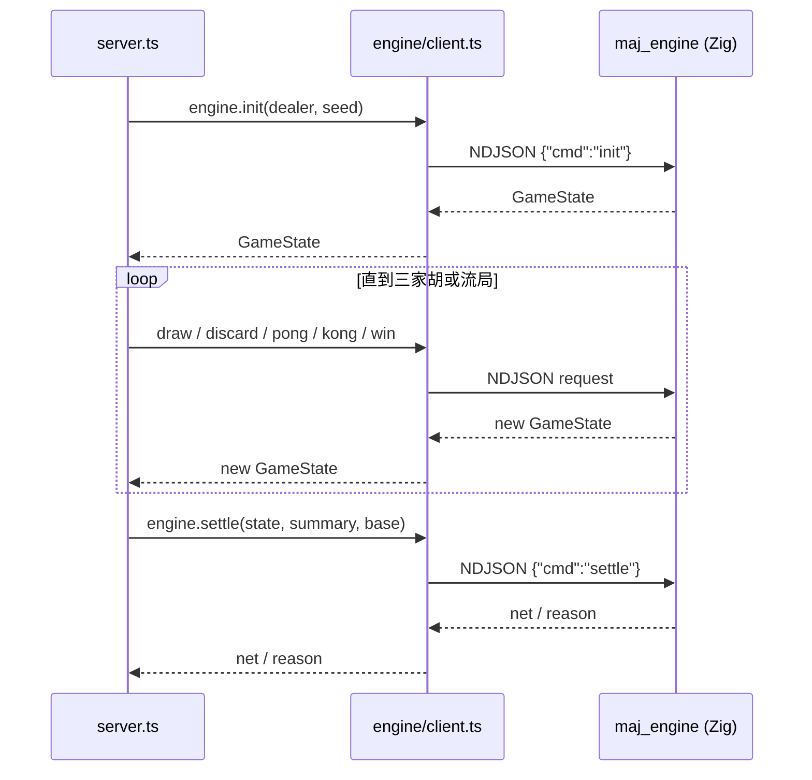
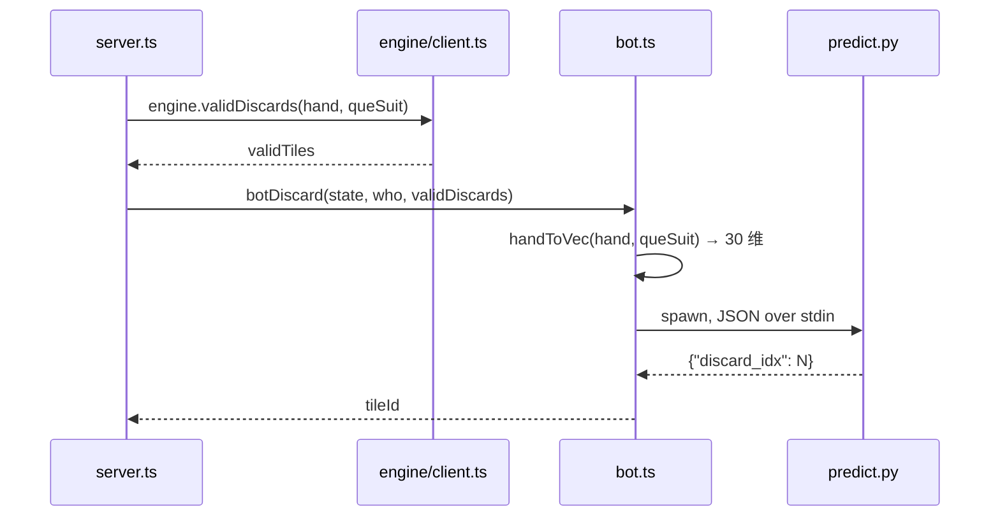
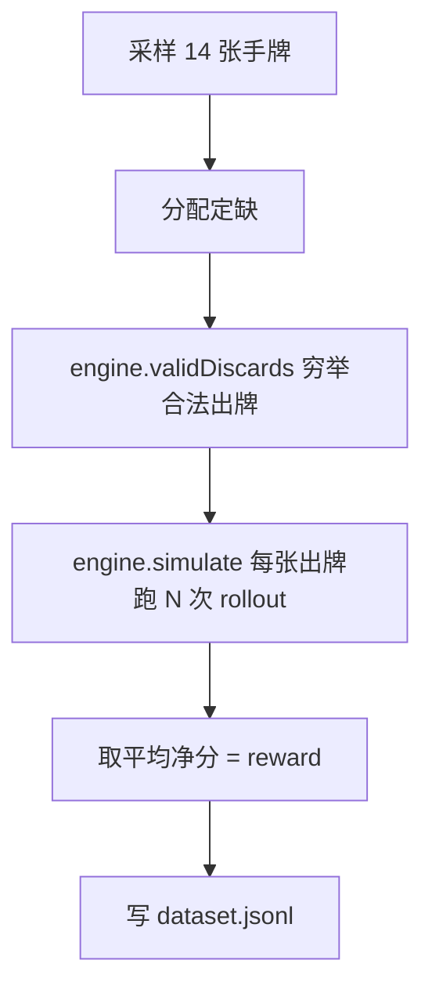

# 数据流

## 对局主循环

引擎侧每个请求使用独立 arena 分配器，请求结束后重置，避免内存增长。

## 推理调用

bot 在 `discard` 阶段需要出牌时：

## Rollout 数据生成

`engine.simulate` 在 Zig 引擎内一次性模拟整局到结束（原生快路径），避免逐动作跨进程往返。每次 rollout 用种子化随机对手模拟一局，统计玩家 0 的净分；固定 seed 保证数据可复现。
