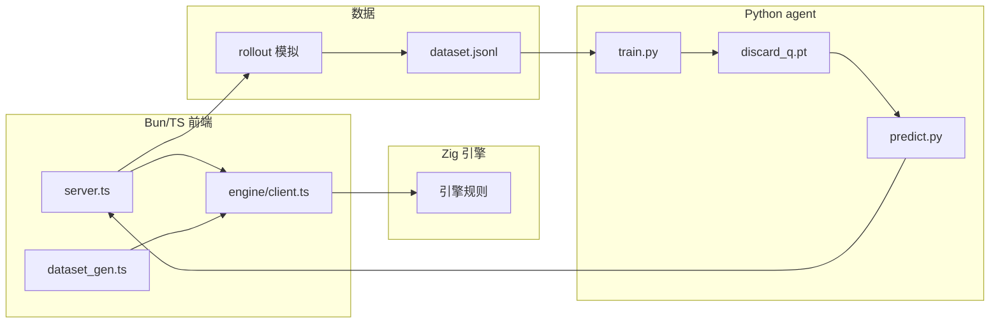

# 架构总览

Maj_Mini 是「Zig 规则引擎 + Bun/TS 前端 + AI 训练」的项目。

## 模块划分

| 层         | 路径                                  | 职责                                          |
| ---------- | ------------------------------------- | --------------------------------------------- |
| 引擎核心   | `backend/src/`                        | 类型、规则、行动、计分、结算、初始化、rollout |
| 引擎客户端 | `src/engine/`                         | 子进程 + NDJSON 协议客户端                    |
| AI 层      | `src/ai/`                             | 数据生成、特征、bot 推理桥接、终端显示        |
| 共享类型   | `src/ts/`                             | 前后端共用的 DTO 类型                         |
| 训练       | `agent/`                              | PyTorch 模型、训练、推理服务                  |
| 入口       | `src/server.ts`                       | 终端对局主循环                                |
| 测试       | `backend/src/tests.zig` + `src/test/` | 引擎单元测试与前端固定牌局 demo               |

## 技术栈

- **引擎**：Zig 0.17（无 I/O 纯逻辑 + stdio NDJSON 协议）
- **前端**：Bun + TypeScript + lodash
- **训练**：Python + PyTorch + numpy，uv 管理环境
- **桥接**：`engine/client.ts` 驱动 Zig 子进程；`bot.ts` spawn `predict.py`，JSON over stdin/stdout
