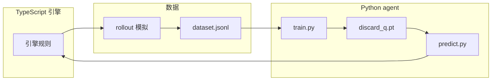

# 架构总览

Maj_Mini 是「游戏引擎 + AI 训练」双栈项目。

## 模块划分

| 层 | 路径 | 职责 |
| --- | --- | --- |
| 引擎核心 | `src/ts/` | 类型、规则、行动、计分、结算、初始化 |
| AI 层 | `src/ai/` | rollout、数据生成、特征、bot 推理桥接 |
| 训练 | `agent/` | PyTorch 模型、训练、推理服务 |
| 入口 | `src/server.ts` | 终端对局主循环 |
| 测试 | `src/test/` | 单元测试与固定牌局 demo |

## 技术栈

- **引擎**：Bun + TypeScript + immer（不可变状态）+ lodash
- **训练**：Python + PyTorch + numpy，uv 管理环境
- **桥接**：`bot.ts` spawn `predict.py`，JSON over stdin/stdout