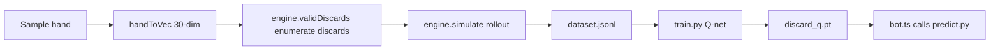

# AI Training

AI training uses a **supervised (regression)** paradigm: rollout estimates the expected net score of each discard as a label, and a Q-network is trained to fit it.

## Pipeline



## Model

`agent/model.py`'s `DiscardQ` is a 3-layer MLP:

```
input 30-dim → 128 → 128 → 27 (Q-value per action)
```

- **Input**: 30 dims = 27 tile counts + 3 que-suit one-hot
- **Output**: expected value for each of 27 discard actions
- **Inference**: argmax after masking illegal tiles

## Training enhancements

| Option                 | Effect                                                      |
| ---------------------- | ----------------------------------------------------------- |
| `--relative-advantage` | Target becomes within-hand relative advantage (recommended) |
| `--normalize-reward`   | Stabilizes reward scale                                     |
| `--val-frac`           | Validation split fraction                                   |
| `--patience`           | Early-stop patience, prevents overfitting                   |

::: tip Why relative advantage
The discard decision is "pick the best tile within this hand", not an absolute score. `advantage = reward - mean(reward of this hand's discards)` lets the model learn relative quality; argmax is unchanged.
:::
