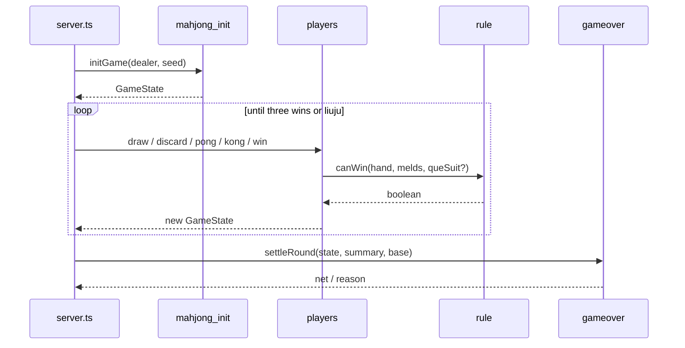
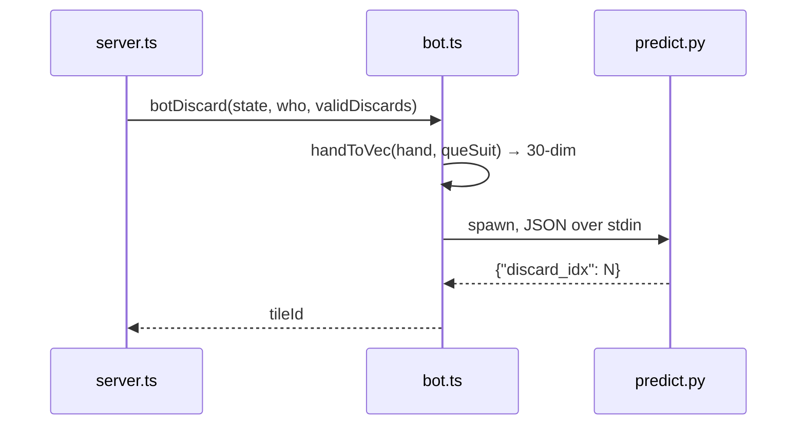
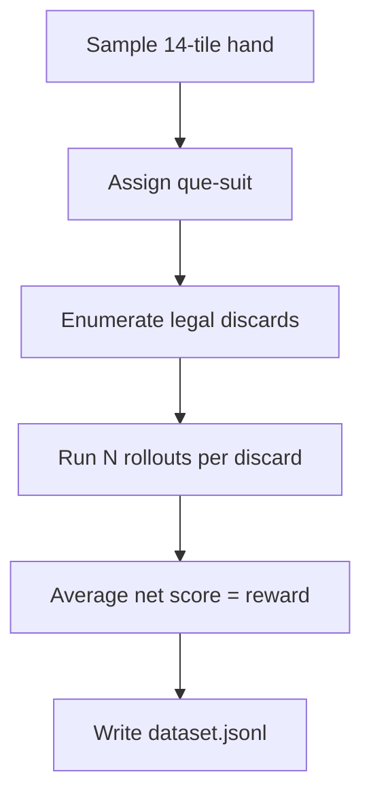

# Data Flow

## Game main loop

## Inference call

When the bot must discard during the `discard` phase:

## Rollout data generation

Each rollout uses seeded random opponents to simulate a full game, then records player 0's net score. A fixed seed makes the data reproducible.