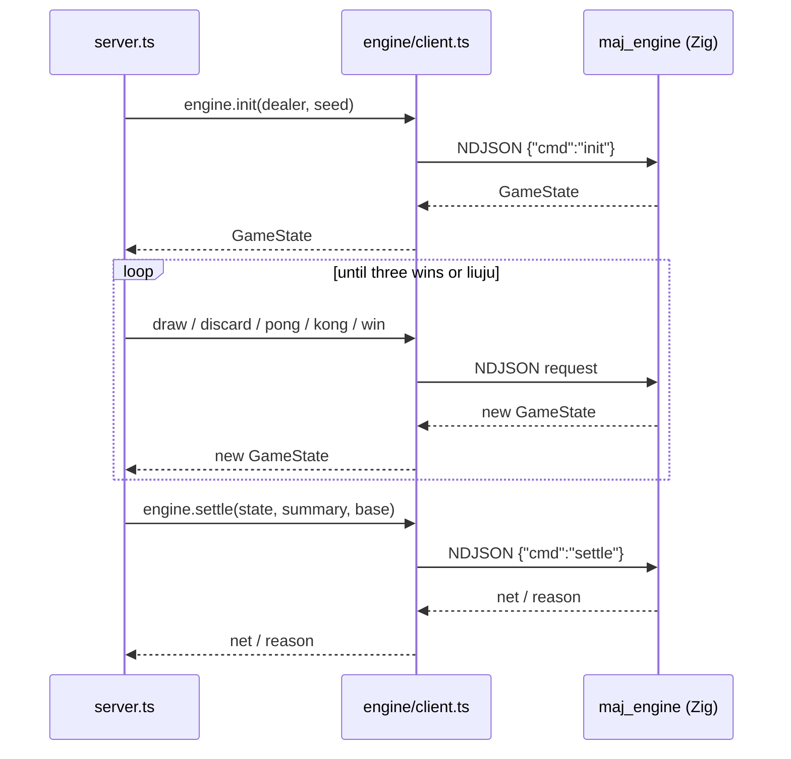
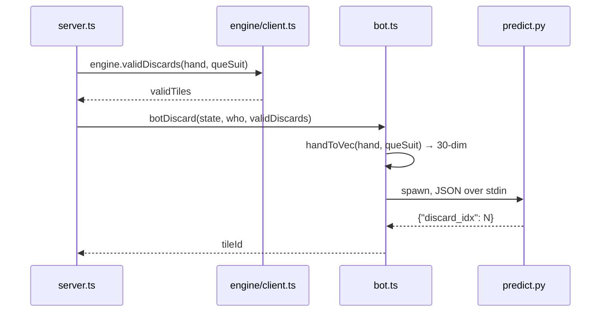
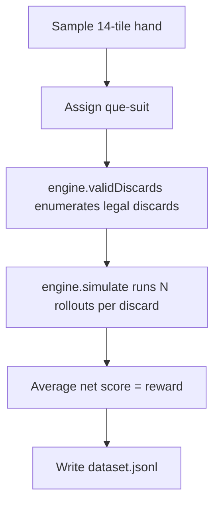

# Data Flow

## Game main loop

Each request gets its own arena allocator on the engine side, reset afterwards to keep memory flat.

## Inference call

When the bot must discard during the `discard` phase:

## Rollout data generation

`engine.simulate` plays a whole game to completion inside the Zig engine (a native fast path), avoiding per-action round trips. Each rollout uses seeded random opponents and records player 0's net score; a fixed seed makes the data reproducible.
