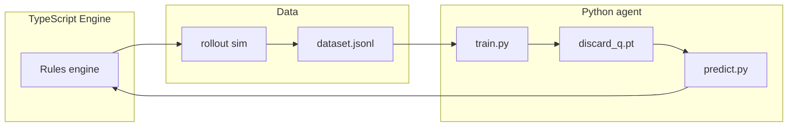

# Architecture Overview

Maj_Mini is a dual-stack project: a game engine plus AI training.

## Modules

| Layer | Path | Responsibility |
| --- | --- | --- |
| Engine core | `src/ts/` | Types, rules, actions, scoring, settlement, init |
| AI layer | `src/ai/` | Rollout, data generation, features, inference bridge |
| Training | `agent/` | PyTorch model, training, inference server |
| Entry | `src/server.ts` | Terminal game main loop |
| Tests | `src/test/` | Unit tests and fixed-hand demo |

## Stack

- **Engine**: Bun + TypeScript + immer (immutable state) + lodash
- **Training**: Python + PyTorch + numpy, env managed by uv
- **Bridge**: `bot.ts` spawns `predict.py`, JSON over stdin/stdout