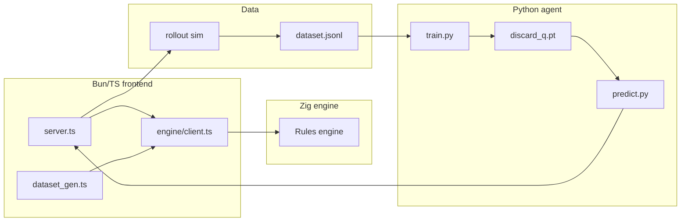

# Architecture Overview

Maj_Mini is a Zig rule engine + Bun/TS frontend + AI training project.

## Modules

| Layer         | Path                                  | Responsibility                                                |
| ------------- | ------------------------------------- | ------------------------------------------------------------- |
| Engine core   | `backend/src/`                        | Types, rules, actions, scoring, settlement, init, rollout     |
| Engine client | `src/engine/`                         | Subprocess + NDJSON protocol client                           |
| AI layer      | `src/ai/`                             | Data generation, features, inference bridge, terminal display |
| Shared types  | `src/ts/`                             | DTO types shared across the boundary                          |
| Training      | `agent/`                              | PyTorch model, training, inference server                     |
| Entry         | `src/server.ts`                       | Terminal game main loop                                       |
| Tests         | `backend/src/tests.zig` + `src/test/` | Engine unit tests and frontend fixed-hand demo                |

## Stack

- **Engine**: Zig 0.17 (pure logic plus a stdio NDJSON protocol)
- **Frontend**: Bun + TypeScript + lodash
- **Training**: Python + PyTorch + numpy, env managed by uv
- **Bridge**: `engine/client.ts` drives the Zig subprocess; `bot.ts` spawns `predict.py`, JSON over stdin/stdout
